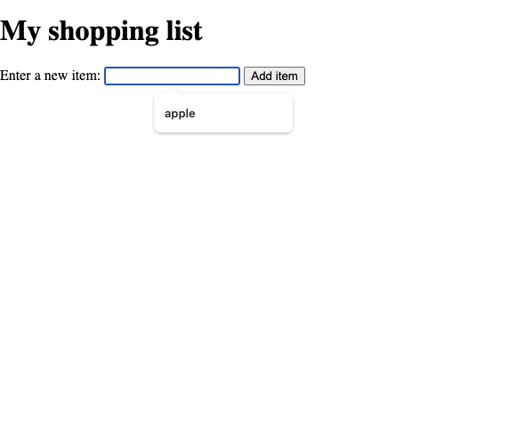
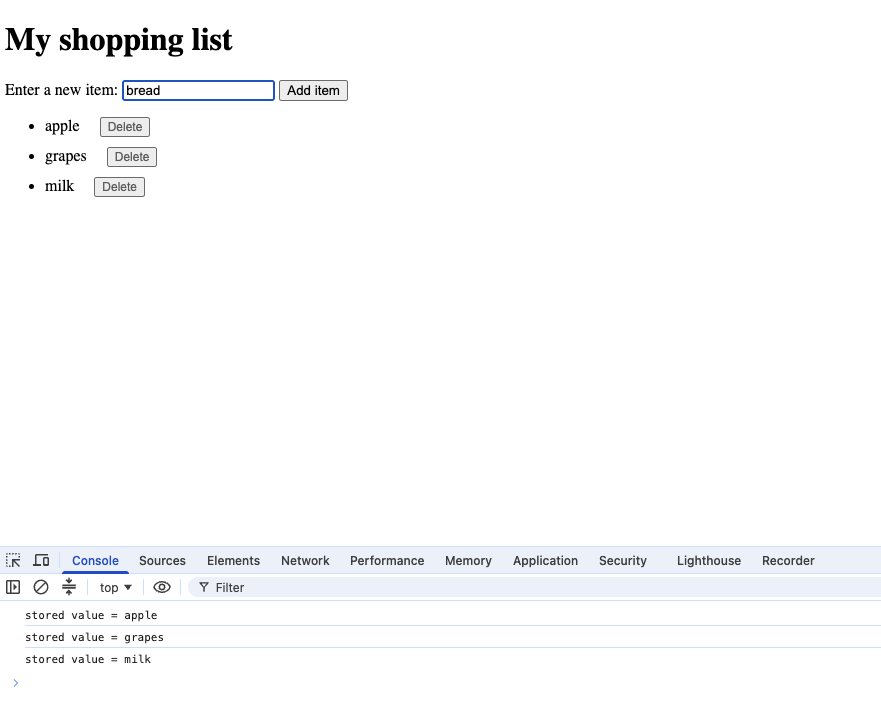

# Shopping List

A simple interactive shopping list built using HTML, CSS, and JavaScript. This project allows users to dynamically add items to a shopping list and delete them when they are no longer needed.

## Screenshots

### Empty Shopping List



### Shopping List with Items



## Features

- **Add Items:** Enter an item in the input field and click the "Add item" button to add it to the list.
- **Delete Items:** Remove individual items by clicking the "Delete" button next to them.
- **Clear Input:** Automatically clears the input field after adding an item.
- **Auto Focus:** Automatically focuses on the input field after adding an item, making it easier to enter the next item.
- **Dynamic List:** Creates and updates list elements dynamically using JavaScript.

## Technologies Used

- HTML5
- CSS3
- JavaScript

## JavaScript Concepts Practiced

- Selecting DOM elements using `querySelector()`.
- Creating HTML elements dynamically using `createElement()`.
- Updating element content using `textContent`.
- Adding elements to the DOM using `appendChild()`.
- Handling events using `addEventListener()`.
- Working with input values using `.value`.
- Preventing default form submission using `preventDefault()`.
- Removing elements from the DOM using `removeChild()`.
- Using `focus()` to improve user interaction.
- Passing elements as function arguments.
- Using arrow functions for event handling.

## How to Run Locally

1. Clone this repository:

   ```bash
   git clone <your-repository-url>
   ```

2. Navigate to the project directory:

   ```bash
   cd shopping-list
   ```

3. Open `shopping-list.html` in your browser.

## Project Reference

This exercise was completed as part of my JavaScript learning journey, following the [MDN JavaScript Shopping List Exercise](https://developer.mozilla.org/en-US/docs/Learn_web_development/Core/Scripting/DOM_scripting#creating_a_dynamic_shopping_list).

---

_Built as part of my journey to learn JavaScript and practice DOM manipulation._
